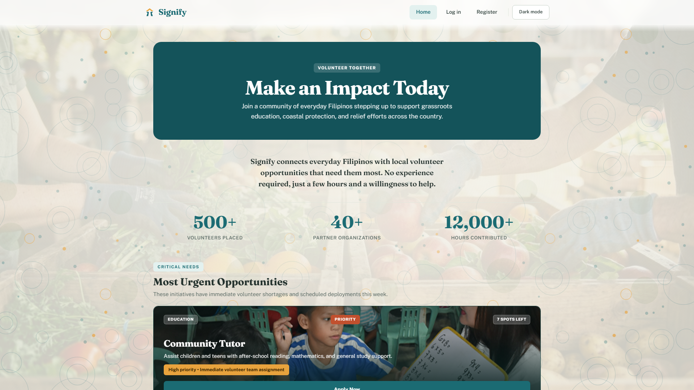
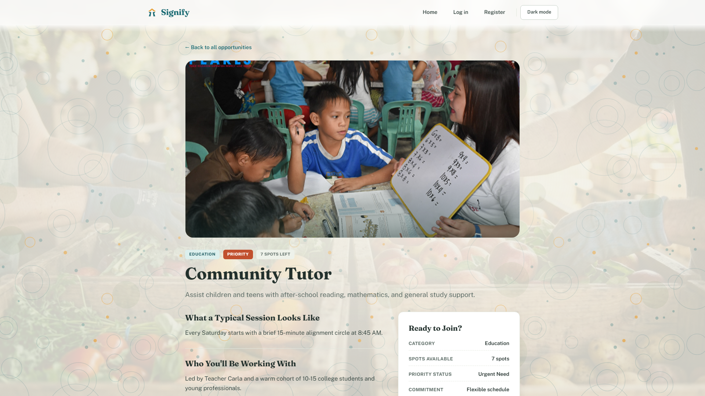
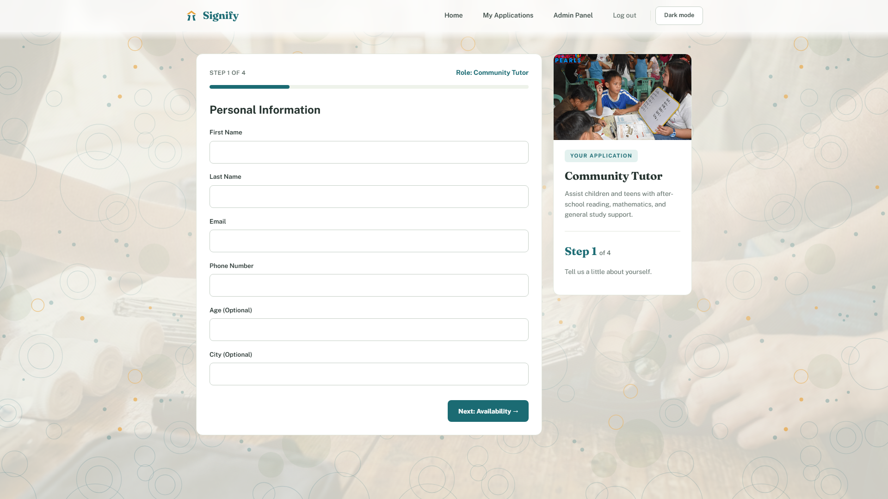
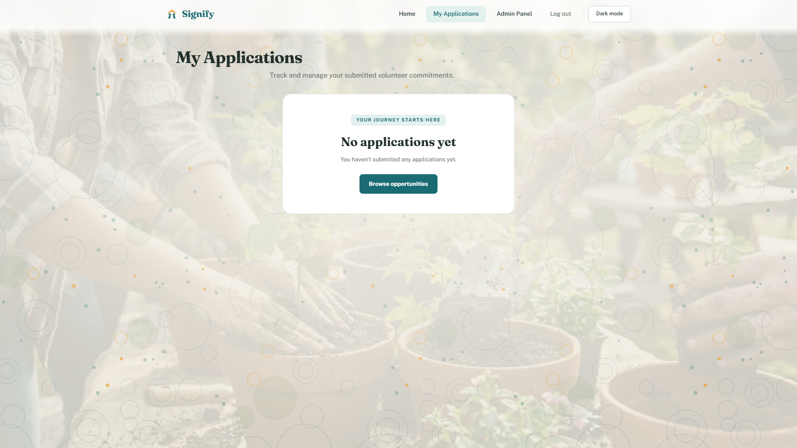
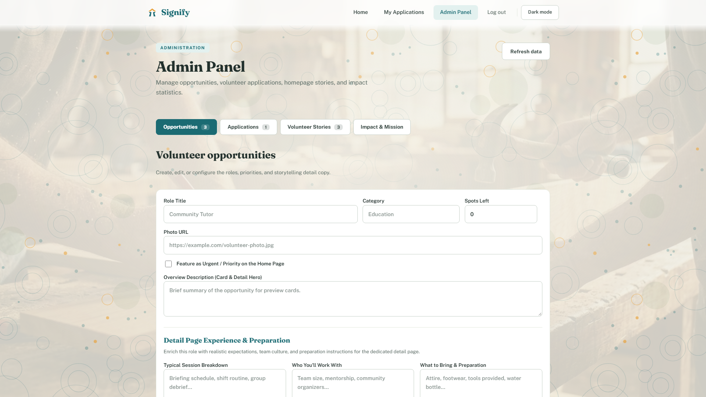

# Signify — Full-Stack Volunteer Sign-Up Portal

> **Final Project: Full-Stack Form Application**  
> **Chosen Topic:** Project #9 — Volunteer Sign-Up Form  
> **Frontend:** React + Vite + TypeScript (Bayanihan Vanilla CSS Design System)  
> **Backend:** Node.js + Express REST API  
> **Database:** MariaDB / MySQL with Connection Pool & Parameterized Queries  
> **Integration:** Axios with Request & Response Interceptors + CORS  

---

## 1. Project Overview

**Signify** is a full-stack web application designed to connect volunteers with local community opportunities (education, environmental cleanups, food drives, and community outreach). 

The platform centers on a multi-step **Volunteer Sign-Up Form** with controlled inputs, client-side and server-side Zod validation, automatic form reset on submit, database synchronization, and full CRUD capabilities (create, read, update, delete).

Data travels through a shared **Axios instance** with JWT interceptors to an **Express REST API**, is validated against server schemas, is stored in a **MySQL** database, and updates the user interface reactively without page reloads.

---

## 2. Tech Stack

| Layer | Technologies | Role in Application |
| :--- | :--- | :--- |
| **Frontend** | React 18, Vite, TypeScript | Interactive SPA UI, event handlers, hooks, controlled multi-step form |
| **Styling** | Vanilla CSS (Bayanihan Theme) | Fraunces editorial typography, warm terracotta/teal palette, fluid layouts |
| **API Client** | Axios (`src/api/axios.ts`) | Shared Axios instance, baseURL, JWT request & response interceptors |
| **Custom Hooks**| `useFetch.ts` (`src/hooks/`) | Generic reusable data fetching with loading, error, cleanup, and refetch |
| **Backend** | Node.js, Express | RESTful API routes, custom logger middleware, CORS, JSON parsing, error handling |
| **Validation** | Zod (Client & Server) | Dual-layer schema validation with 400 Bad Request error reporting |
| **Security** | JWT, bcryptjs, Helmet | Token-based authentication, password hashing, HTTP headers hardening |
| **Database** | MariaDB / MySQL (`mysql2`) | Connection pooling, relational schema, foreign keys, parameterized queries |
| **Testing** | Playwright, Node Test Runner | Automated 16:9 screenshot capture, endpoint status verification suite |

---

## 3. Project Structure

```text
Volunteer_Sign_Up_Form_React/
├── client/                               # React (Vite + TypeScript) Frontend
│   ├── src/
│   │   ├── api/
│   │   │   ├── axios.ts                  # Shared Axios instance with JWT interceptors
│   │   │   └── api.ts                    # Typed API service functions
│   │   ├── components/                   # Navbar, PasswordInput, Route Guards
│   │   ├── context/                      # AppContext, AuthContext (JWT session state)
│   │   ├── hooks/
│   │   │   └── useFetch.ts               # Custom data-fetching hook
│   │   ├── pages/
│   │   │   ├── HomePage.tsx              # Browse volunteer opportunities & stories
│   │   │   ├── OpportunityDetailPage.tsx# Role details, schedule, preparation
│   │   │   ├── SignUpPage.tsx             # 4-step controlled sign-up form
│   │   │   ├── MyApplicationsPage.tsx    # Submitted records with Withdraw/Delete action
│   │   │   ├── LoginPage.tsx / RegisterPage.tsx # User authentication
│   │   │   └── AdminPage.tsx             # Dashboard for opportunity & applicant management
│   │   ├── schemas/                      # Client-side Zod validation schemas
│   │   ├── types/                        # TypeScript domain interfaces
│   │   └── index.css                     # Vanilla CSS design tokens & utilities
│   ├── .env.example                      # Frontend environment variable template
│   └── package.json
│
├── server/                               # Express REST API Backend
│   ├── src/
│   │   ├── config/
│   │   │   └── db.js                     # MySQL database connection pool & Sequelize config
│   │   ├── controllers/                  # Business logic (applications, opportunities, auth)
│   │   ├── middleware/
│   │   │   ├── logger.js                 # Custom request logger middleware
│   │   │   ├── validate.js               # Zod validation middleware (returns 400)
│   │   │   ├── requireAuth.js            # JWT verification & optionalAuth middleware
│   │   │   └── errorHandler.js           # Centralized HTTP error handler
│   │   ├── models/                       # Sequelize data models & relational associations
│   │   ├── routes/                       # Express route modules
│   │   ├── schemas/                      # Server-side Zod validation schemas
│   │   ├── app.js                        # Express app configuration & middleware pipeline
│   │   └── server.js                     # Server entrypoint & seeders
│   ├── .env.example                      # Backend environment variable template
│   └── package.json
│
├── schema.sql                            # Clean SQL database setup script & seed data
├── screenshots/                          # Full-screen 16:9 HD application screenshots
│   ├── 01-home-page.png
│   ├── 02-opportunity-details.png
│   ├── 03-signup-form.png
│   ├── 04-my-applications.png
│   └── 05-admin-dashboard.png
└── README.md                             # Comprehensive project documentation
```

---

## 4. Setup and Installation Steps

Follow these steps to set up and run the application locally from scratch:

### Prerequisites
* **Node.js** (v18.0.0 or higher recommended)
* **XAMPP / MariaDB / MySQL Server** running on port `3306`

---

### Step 1: Clone and Install Dependencies

```bash
# In the project root, install dependencies for both client and server:
cd server
npm install

cd ../client
npm install

cd ..
```

---

### Step 2: Set Up the MySQL Database

1. Open **XAMPP** and start the **MySQL** service (port `3306`).
2. Run the automated database setup script:

```bash
npm run db:setup
```
*This automatically reads `schema.sql`, connects to your local MySQL service, creates the `volunteer_app` database, configures all tables, and loads starter seed records.*

*(Alternatively, you can open phpMyAdmin at `http://localhost/phpmyadmin`, click the **Import** tab, choose `schema.sql`, and click **Import**).*

The script creates the `volunteer_app` database, configures all tables (`accounts`, `volunteers`, `applications`, `testimonials`, `site_settings`), and loads initial seed opportunities and demo accounts.

---

### Step 3: Configure Environment Variables

1. In the **`server`** directory, copy the example file to `.env`:
   ```bash
   cp server/.env.example server/.env
   # Or in PowerShell:
   Copy-Item server/.env.example server/.env
   ```
   *Verify that `DB_USER` and `DB_PASSWORD` in `server/.env` match your local MySQL credentials.*

2. In the **`client`** directory, copy the example file to `.env`:
   ```bash
   cp client/.env.example client/.env
   # Or in PowerShell:
   Copy-Item client/.env.example client/.env
   ```

---

### Step 4: Run the Express API Server

```bash
cd server
npm run dev
```
*The server will start at **`http://localhost:3000`** and log:*
```text
[database] MariaDB connection established successfully.
[database] Database tables synchronized.
[auth] Admin account ready: realAdmin (realadmin@example.com).
[server] Server listening on http://localhost:3000
```

---

### Step 5: Run the React (Vite) Frontend

In a separate terminal window:
```bash
cd client
npm run dev
```
*The React application will open at **`http://localhost:5173`**.*

---

## 5. Default Demo Credentials

For quick evaluation during the demo, initial accounts are pre-seeded in `schema.sql`:

| Role | Email | Password | Access Rights |
| :--- | :--- | :--- | :--- |
| **Administrator** | `realadmin@example.com` | `realAdminPassword123!` | Full Admin Panel, Opportunity CRUD, Application Review |
| **Volunteer User** | `volunteer@example.com` | `realAdminPassword123!` | Browse, Apply, View My Applications, Withdraw Applications |

*(You can also click **Register** in the UI to create a brand new volunteer account instantly).*

---

## 6. REST API Endpoint Table

The Express backend follows REST conventions with named controllers, structured status codes, input validation, and request logging.

| Method | Endpoint | Description | Status Codes | Auth Required |
| :--- | :--- | :--- | :---: | :---: |
| `GET` | `/api/volunteers` | List all volunteer opportunities | `200` | No |
| `GET` | `/api/volunteers/:id` | Get single opportunity by ID | `200`, `404` | No |
| `DELETE` | `/api/volunteers/:id` | Delete an opportunity | `200`, `404` | Admin / Token |
| `GET` | `/api/applications` | List submitted applications for user | `200` | Yes (JWT) |
| `GET` | `/api/applications/:id` | Get single application record by ID | `200`, `404` | No / Optional |
| `POST` | `/api/applications` | Submit a new volunteer sign-up | `201`, `400` | Optional / Token |
| `DELETE` | `/api/applications/:id` | Delete/withdraw an application record | `200`, `404` | No / User |
| `POST` | `/api/auth/register` | Register a new user account | `201`, `400` | No |
| `POST` | `/api/auth/login` | Authenticate and obtain JWT token | `200`, `400`, `401` | No |
| `GET` | `/api/auth/me` | Fetch currently logged-in account | `200`, `401` | Yes (JWT) |
| `GET` | `/api/testimonials` | List community volunteer stories | `200` | No |
| `GET` | `/api/site-settings` | Fetch mission statement and impact stats | `200` | No |
| `PATCH` | `/api/admin/applications/:id/status` | Update applicant status (pending/approved/rejected) | `200`, `400`, `404` | Admin (JWT) |
| `PATCH` | `/api/admin/opportunities/:id` | Edit volunteer opportunity details | `200`, `400`, `404` | Admin (JWT) |

---

## 7. Application Screenshots (16:9 Full HD)

### 1. Home Page — Browse Opportunities & Impact

*Hero section with Philippine Bayanihan storytelling, impact statistics, category filters, and live opportunity cards.*

---

### 2. Opportunity Details & Preparation

*Detailed view showing role expectations, session schedule, team composition, and preparation advice.*

---

### 3. Multi-Step Controlled Sign-Up Form

*Step-by-step controlled form with progress indicator, per-field validation error messages, and immediate form reset upon submission.*

---

### 4. My Applications — Real-Time Records & Delete Action

*User-facing record view displaying submitted commitments loaded via the custom `useFetch` hook, equipped with the reactive **Withdraw Application** delete action.*

---

### 5. Admin Dashboard — Full Record Management

*Administrative control center featuring opportunity updates, application approval/rejection workflows, and site settings editing.*

---

## 8. Bonus Features Implemented (Up to +10 Points)

| Bonus Feature | Points | Implementation Details |
| :--- | :---: | :--- |
| **JWT Login, Protected Routes & Axios Interceptors** | **+4** | Built with `jsonwebtoken` and `bcryptjs`. Implemented `RequireAuth` and `RequireAdmin` route guards. Configured Axios request interceptor for automated `Bearer` header attachment and response interceptor for automatic 401 handling. |
| **Edit or Update Records (PUT / PATCH)** | **+3** | Implemented `PATCH /api/admin/opportunities/:id` and `PATCH /api/admin/applications/:id/status` allowing real-time record editing in the database. |
| **Meaningful Use of `useContext`** | **+2** | `AuthContext` manages global session tokens, login states, and logout across the tree; `AppContext` manages application navigation drafts and selections. |
| **Search or Filter Functionality** | **+2** | Dynamic keyword search and category filtering (Education, Environment, Outreach) across opportunities and applicant records. |

---

## 9. Acknowledgements & AI Assistance Disclosure

In accordance with course guidelines:

* **AI Assistance:** Generative AI tools (such as GitHub Copilot and ChatGPT) were used as educational aids for syntax assistance, HTML/CSS layout scaffolding, and debugging support.
* **Learning References:** Application architecture, Express routes, and React state management were structured based on course lecture slides, classroom exercises, and official React/Express/MySQL documentation.

---

## 10. Known Issues & Troubleshooting

1. **Database Connection Error (`ECONNREFUSED 3306`):**
   * Ensure that the MySQL/MariaDB service is started in your XAMPP Control Panel before launching the Express server.
2. **CORS Warning:**
   * The server reads `FRONTEND_ORIGINS` from `server/.env`. If running on a non-standard port, update `FRONTEND_ORIGINS=http://localhost:YOUR_PORT` accordingly.
